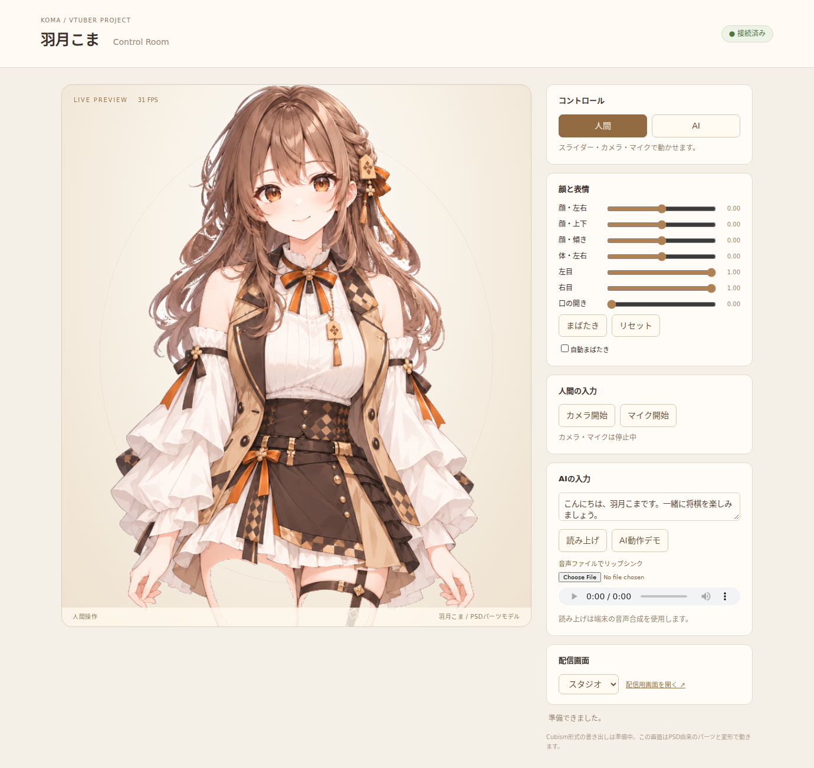
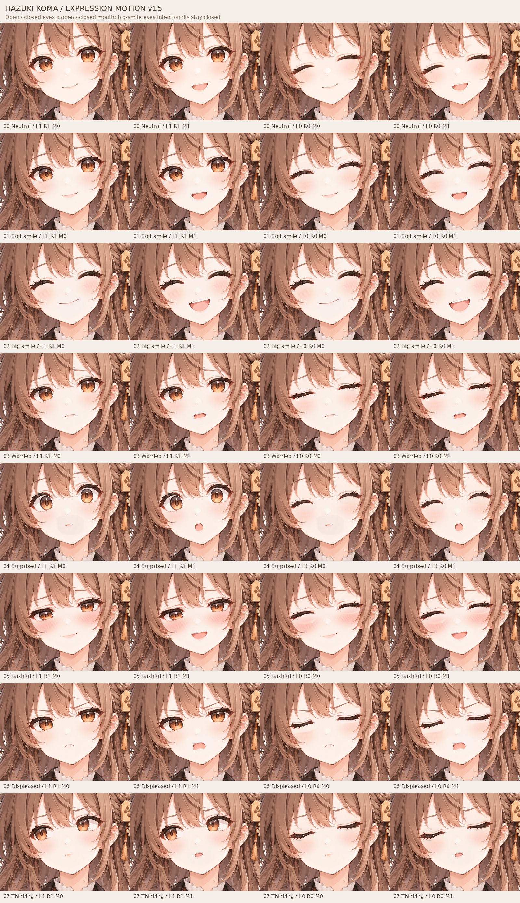
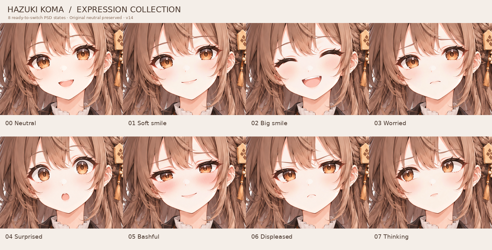

# 羽月こま — VTuber Project

人間とAIの両方で操作するVTuberの制作プロジェクトです。

## 現在の成果（表情・動作 v15）

- 元の 66 レイヤーを保持した 115 レイヤーの表情 PSD。7 表情に左右の目と口の開閉差分を追加。
- 元の通常表情と左右個別を含む 8 通りの旧来の目・口の組み合わせは、v9 と RGBA 全画素で一致。
- WebGL操作画面。まばたき・口の開閉、顔と体の変形、呼吸に対応。
- 身体は腰を支点に動き、首・肩・腕・前腕がつながって追従。腕には小さな遅れを持たせています。
- 人間: カメラの顔追跡、マイクの音量、スライダー。
- AI: HTTP/WebSocketのパラメータ指示、テキスト読み上げ要求、音声ファイルのリップシンク。
- 透明・グリーン背景と配信用表示。
- AI待機時の揺れ、発話時のうなずき、楽しそう／考え中／びっくりの仕草。



## 表情を動かす（v15）

8 表情を操作画面から選び、各表情に対応したまばたき・実音量に連動する口パクで動かせます。
切り替え時は目と口を短く閉じ、閉じ際に表情を切り替えます。顔全体の半透明クロスフェードはしません。
まばたきは描かれた開眼・閉眼の 2 状態を切り替え、口の中間形状は口まわりの狭い範囲だけの局所変形で作ります。にっこりの目は閉じたデザインを保持します。

最新 PSD は `assets/parts/v15/koma_expression_motion_v15.psd`。
[起動・使い方・動画と検証の範囲](docs/expression-motion-v15.md) を参照してください。
v14 のファイルは前段階の静止表情として残しています。



[42 秒の音声付き動画サンプル](assets/parts/v15/koma-v15-expression-motion.mp4)。実行版と同じ計算を使ったオフライン OpenGL 再描画で、操作画面の録画ではありません。保存済み音声を再使用しています。
[動画の再生成手順](scripts/video_v15/RERUN.txt)。

## 表情コレクション（PSD v14）

元の通常表情を保持したまま、微笑み・にっこり・困り顔・驚き・照れ・不満・考え顔を追加しました。
`assets/parts/v14/koma_expression_collection_v14.psd` の EXP フォルダーを 1 個だけ表示して切り替えます。
元の 66 レイヤーは保持し、7 個の描き下ろし表情レイヤーを追加しています。
各表情は眉・目・口・頬をまとめた顔差分です。新表情ごとの独立した瞬き・口パクや実行画面への反映は含みません。



[使い方・検証範囲](docs/expressions-v14.md)。Photoshop 用の選択スクリプトと日本語の説明書も同じフォルダーにあります。
v14 時点の実行版は v10 素材でしたが、v15 で表情用の描画素材と動作を統合しています。

## 起動

Python 3.10以降。Chrome/Edge等のWebGL対応ブラウザを使います。

```bash
python -m pip install -r requirements.txt
python scripts/run_runtime.py
```

ブラウザで **http://127.0.0.1:8766/** を開いてください。
初回だけ顔追跡のモデル/WASMを取得し、SHA-256で照合します。取得後の追跡はローカルで実行します。
カメラ・マイクはボタンを押したときに開始します。
コントロール画面を開いたまま、OBSのブラウザソース等で `http://127.0.0.1:8766/?overlay=1` を表示できます。

## AIから操作

起動したコントロール画面を開いてから実行します。

```bash
python runtime/ai_client.py --demo
python runtime/ai_client.py --say "こんにちは、羽月こまです。"
```

既存のAIプログラムから直接呼べます。

```python
from runtime.ai_client import KomaClient

koma = KomaClient()
koma.select("ai")
koma.pose(ParamAngleX=8, ParamEyeLOpen=0, ParamMouthOpenY=1)
koma.say("次の一手を考えています。")
```

会話AI/LLMそのものはまだ接続していません。
人間/AIの切り替えで前の入力を停止し、外部からの指示が途切れると2秒で通常姿勢へ戻ります。
読み上げはローカルのVOICEVOXを使います（仮音声：VOICEVOX:雨晴はう）。VOICEVOX未起動時は起動案内を表示し、別の声へ自動で置き換えません。音声ファイルとマイクではWeb Audioの音量に合わせて口を動かします。

## PSDと再生成

最新 PSD は `assets/parts/v15/koma_expression_motion_v15.psd` です。元の統合データは `assets/parts/v10/koma_integrated_v10.psd`、静止表情版は v14 に保持しています。承認済み原画と旧PSDは上書きしていません。

```bash
python scripts/build_integrated_v10.py
python scripts/export_runtime_model.py
python scripts/build_expressions_v15.py
python tests/test_expressions_v15.py
python tests/test_integrated_v10.py
python tests/test_runtime_server.py
node --test runtime/tests/*.test.js
```

保存した描画素材から再ビルドでき、画像生成を再実行する必要はありません。

## 残っている工程

**正式なCubismモデル（cmo3/moc3/model3.json）は未作成です。** 現在の実行版はPSD由来素材を独自の2Dメッシュで動かしています。
目・口は描画された開閉 2 状態と局所変形を組み合わせて動かします。音素別の口形状、立体的な顔の向き、パーツごとの物理演算は今後の工程です。
元の髪の外周マットにも荒れが残るため、PSD全体を最終美術合格にはしていません。

[制作・検証記録](docs/v10-production-runtime.md) / [身体の動きの修正](docs/body-motion-v11.md) / [Cubism引き継ぎ設定](config/cubism_rig_v10.json)

## 無料音声で発話（v12）

VOICEVOXを起動して `python scripts/run_runtime.py` → 「読み上げ」。日本語音声に合わせて口が動きます。[起動・AI接続・検証](docs/free-voice-v12.md)。仮音声：VOICEVOX:雨晴はう。

## 待機・発話の仕草（v13）

再開時の手順と今回確認した範囲は [v13 起動・確認メモ](docs/v13-recovery-handoff.md) を参照してください。

AI操作時に首と身体が自然に揺れ、発話にうなずき・首かしげなどが付きます。操作画面の「自然な動き」「発話の雰囲気」から指定できます。[使い方とAI API](docs/lively-motion-v13.md)。
