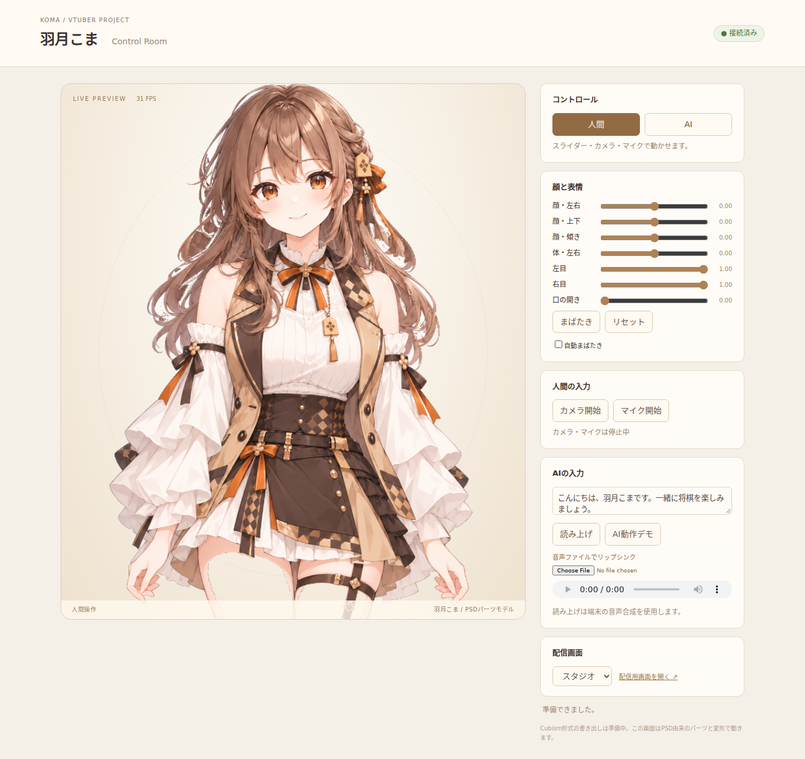

# 羽月こま — VTuber Project

人間とAIの両方で操作するVTuberの制作プロジェクトです。

## 現在の成果（v11 / PSDはv10）

- 66レイヤーの統合PSD。v9の表情、既存の袖・腕・手、髪・ベストの描画下地を統合。
- 通常合成と左右個別を含む8通りの表情は、v9とRGBA全画素で一致。
- WebGL操作画面。まばたき・口の開閉、顔と体の変形、呼吸に対応。
- 身体は腰を支点に動き、首・肩・腕・前腕がつながって追従。腕には小さな遅れを持たせています。
- 人間: カメラの顔追跡、マイクの音量、スライダー。
- AI: HTTP/WebSocketのパラメータ指示、テキスト読み上げ要求、音声ファイルのリップシンク。
- 透明・グリーン背景と配信用表示。



## 起動

Python 3.10以降。Chrome/Edge等のWebGL対応ブラウザを使います。

```bash
python -m pip install -r requirements.txt
python scripts/run_runtime.py
```

ブラウザで **http://127.0.0.1:8766/** を開いてください。
初回だけ顔追跡のモデル/WASMを取得し、SHA-256で照合します。取得後の追跡はローカルで実行します。
カメラ・マイクはボタンを押したときに開始します。
コントロール画面を開いたまま、OBSのブラウザソース等で `http://127.0.0.1:8766/?overlay=1` を表示できます。

## AIから操作

起動したコントロール画面を開いてから実行します。

```bash
python runtime/ai_client.py --demo
python runtime/ai_client.py --say "こんにちは、羽月こまです。"
```

既存のAIプログラムから直接呼べます。

```python
from runtime.ai_client import KomaClient

koma = KomaClient()
koma.select("ai")
koma.pose(ParamAngleX=8, ParamEyeLOpen=0, ParamMouthOpenY=1)
koma.say("次の一手を考えています。")
```

会話AI/LLMそのものはまだ接続していません。
人間/AIの切り替えで前の入力を停止し、外部からの指示が途切れると2秒で通常姿勢へ戻ります。
読み上げは端末の音声合成を使います。音声ファイルとマイクではWeb Audioの音量に合わせて口を動かします。

## PSDと再生成

`assets/parts/v10/koma_integrated_v10.psd` が最新候補です。承認済み原画と旧PSDは上書きしていません。

```bash
python scripts/build_integrated_v10.py
python scripts/export_runtime_model.py
python tests/test_integrated_v10.py
python tests/test_runtime_server.py
node --test runtime/tests/*.test.js
```

保存した描画素材から再ビルドでき、画像生成を再実行する必要はありません。

## 残っている工程

**正式なCubismモデル（cmo3/moc3/model3.json）は未作成です。** 現在の実行版はPSD由来素材を独自の2Dメッシュで動かしています。
目・口は開閉2状態の切り替えです。中間形状、立体的な顔の向き、パーツごとの物理演算は次の工程です。
元の髪の外周マットにも荒れが残るため、PSD全体を最終美術合格にはしていません。

[制作・検証記録](docs/v10-production-runtime.md) / [身体の動きの修正](docs/body-motion-v11.md) / [Cubism引き継ぎ設定](config/cubism_rig_v10.json)
